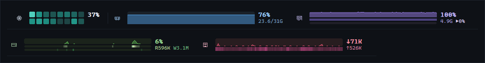
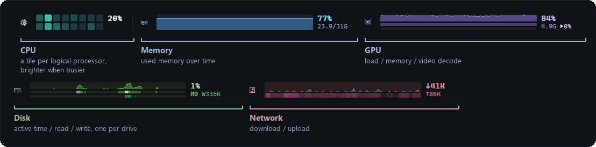
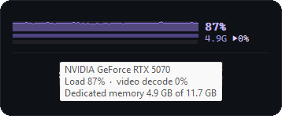
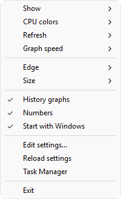
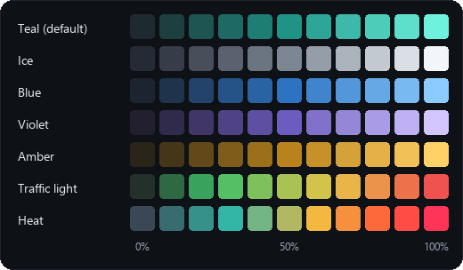
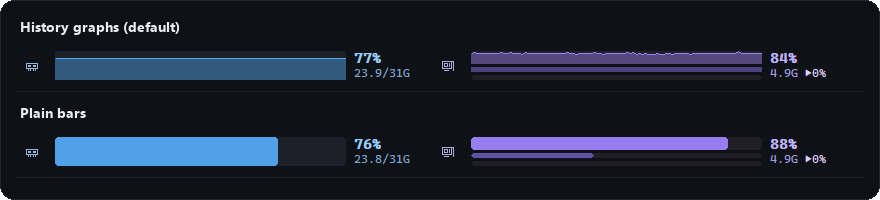

<h1 align="center">Glance</h1>

<p align="center">
  A tiny system-monitor bar for Windows.<br>
  CPU, memory, GPU, disks and network, docked to the edge of your screen as live history graphs.
</p>

<p align="center">
  <a href="https://github.com/Vasiniks/glance/releases/latest"></a>
  <a href="https://github.com/Vasiniks/glance/actions/workflows/build.yml"></a>
  
  
  <a href="LICENSE"></a>
</p>

<p align="center">
  
</p>
<p align="center"><sub>The real bar, recorded at 10 readings a second and split into two rows to fit this page. It is one strip across the top of the screen.</sub></p>

<p align="center">
  <b>One 50 KB exe</b> &nbsp;·&nbsp; <b>~2 ms of CPU per second</b> &nbsp;·&nbsp; <b>~6 MB of memory</b> &nbsp;·&nbsp; <b>no runtime, no service, no admin</b>
</p>

## Install

In **Git Bash** (it comes with [Git for Windows](https://git-scm.com/download/win)), MSYS2 or WSL:

```bash
curl -fsSL https://raw.githubusercontent.com/Vasiniks/glance/main/install.sh | bash
```

That downloads the latest release to `%LOCALAPPDATA%\Programs\Glance`, starts it, and starts it again whenever you sign in (add `-s -- --no-startup` to skip that). To remove it:

```bash
curl -fsSL https://raw.githubusercontent.com/Vasiniks/glance/main/install.sh | bash -s -- --uninstall
```

Prefer no installer? Download `Glance.exe` from [Releases](https://github.com/Vasiniks/glance/releases/latest) and run it. Windows 10 or 11, 64-bit.

## What's on the bar



| Widget | Graph | Numbers |
| --- | --- | --- |
| **CPU** | One tile per logical processor, brighter when busier. On hybrid CPUs, performance cores sit above efficiency cores. | Total load (plus P/E averages on hybrid CPUs) |
| **Memory** | Memory in use | Used %, used / total GB |
| **GPU** | Load, memory, video decode | Load %, memory used, ▶ decode % |
| **Disk**, one per drive | Active time, read, write | Active %, read / write per second |
| **Network** | Download, upload | ↓ / ↑ per second |

Read and write, download and upload are scaled to the fastest rate seen since Glance started. It docks the way the taskbar does: maximized windows sit beside it, and fullscreen games cover it.

<table>
  <tr>
    <td valign="top" width="58%">
      <b>Hover for details.</b> Every widget has a tooltip with exact figures: the GPU's name and memory, each drive's read and write speed, the network adapter in use.
      <br><br>
      <br><br><b>Click</b> the bar to open Task Manager. <b>Right-click</b> it, or its tray icon, for the menu.
    </td>
    <td valign="top" width="42%">
      
    </td>
  </tr>
</table>

## Make it yours

Everything is in the right-click menu:

| Menu | What it does |
| --- | --- |
| **Show** | Turn memory, GPU, disks or network on and off. A hidden widget also stops being measured. |
| **CPU colors** | Pick a palette for the CPU tiles (below), or set your own colors in the settings file. |
| **Refresh** | How often readings are taken: 10 times a second down to every 2 seconds. |
| **Graph speed** | How fast the graphs scroll: 0.1 s to 1 minute per step. Each step averages the readings taken during it, so you can pair live numbers with a slow graph covering hours. |
| **History graphs** / **Numbers** | Graphs or plain bars; numbers beside each widget or graphics only. |
| **Edge** / **Size** / **Display** | Top, bottom, left or right; four thicknesses; which monitor (when you have more than one). |
| **Start with Windows** | Launch at sign-in. |

<p align="center">
  
  
</p>

<details>
<summary><b>The settings file</b>: <code>glance.ini</code>, next to <code>Glance.exe</code></summary>

**Edit settings…** in the menu opens it; **Reload settings** applies your edits.

```ini
[glance]
edge=top            ; top, bottom, left, right
size=40             ; bar thickness in DIPs, 24-200
interval=1000       ; refresh in milliseconds, 100-5000
graph_step=1000     ; milliseconds per graph step (scroll speed), 100-60000
display=0           ; 0 = primary, 1..n = a specific display
graphs=1            ; 0 = plain bars
readouts=1          ; numbers beside each widget
ram=1
gpu=1
disks=1
network=1
taskmgr=1           ; left-click opens Task Manager
cpu_colors=teal     ; a preset, or 2-5 colors from idle to busy, e.g. #1b2433,#7aa2f7,#ff6b9a
adapter=            ; show the network adapter whose name contains this (default: the busiest)
gpu_adapter=        ; show the GPU whose name contains this (default: the one with the most video memory)
```

</details>

## How light is it?

Measured with the release build on Windows 11 (16 logical processors, RTX 5070, one SSD), every widget on, 60 seconds per row after a warm-up. CPU time is the process's CPU time per second; memory is Task Manager's Memory column.

| Refresh | CPU time | Task Manager CPU | Memory |
| --- | --- | --- | --- |
| Every second (default) | 1.8 ms/s | about 0.01 % | 6.0 MB |
| 10 times a second | 18–19 ms/s | about 0.1 % | 5.8–6.0 MB |

- Nearly all of the cost is taking readings, so it grows with the refresh rate. Graph speed and drawing barely register: 10 readings a second with plain bars measured the same.
- The GPU is the priciest reading: Windows reports GPU load per process per engine (549 counters on this machine). Hiding the GPU widget drops them; at 1 reading a second that took CPU time from 3.5 to 1.0 ms/s in an earlier run.
- Nothing grows while it runs: two minutes at 10 readings a second held steady at 244 handles, 14 GDI objects and 6 MB.

It stays small by being one C++ file on Windows' own APIs: GDI to draw, PDH performance counters to read, and a one-off DXGI lookup to find the GPU. No threads, no C++ runtime, no third-party code, and history lives in fixed-size buffers.

## Build from source

With [llvm-mingw](https://github.com/mstorsjo/llvm-mingw) or MSYS2's mingw-w64 on your `PATH`:

```bash
./build.sh          # writes build/Glance.exe
```

With Visual Studio:

```powershell
cmake -B build-msvc
cmake --build build-msvc --config Release
```

Every push is built by GitHub Actions with both toolchains; pushing a `v*` tag publishes `Glance.exe` as a release.

## License

[MIT](LICENSE)
