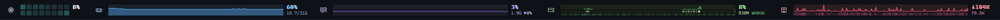
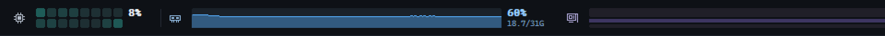

# Glance

A tiny system-monitor bar for Windows: CPU, memory, GPU, disks and network, docked to an edge of your screen and drawn as live history graphs.





- **One 50 KB exe.** No runtime to install, no background service, no installer framework.
- **About 2 ms of CPU per second and 6 MB of memory** at the default refresh ([measured below](#how-light-is-it)).
- Docks like the taskbar: maximized windows sit beside it, fullscreen games cover it.

## Install

Run this in **Git Bash** (comes with [Git for Windows](https://git-scm.com/download/win)), MSYS2 or WSL:

```bash
curl -fsSL https://raw.githubusercontent.com/Vasiniks/glance/master/install.sh | bash
```

Uninstall:

```bash
curl -fsSL https://raw.githubusercontent.com/Vasiniks/glance/master/install.sh | bash -s -- --uninstall
```

The installer downloads the latest release to `%LOCALAPPDATA%\Programs\Glance`, starts it, and has it start when you sign in (`--no-startup` skips that). It needs no admin rights and touches nothing else. Or download `Glance.exe` from [Releases](https://github.com/Vasiniks/glance/releases) and just run it.

Windows 10 or 11, 64-bit.

## What it shows

| Widget | Graph | Numbers |
| --- | --- | --- |
| CPU | One tile per logical processor, brighter when busier. Hybrid CPUs show performance cores above efficiency cores. | Total load |
| Memory | Used | Used %, used / total GB |
| GPU | Load, memory, video decode | Load %, memory used, ▶ decode % |
| Disk (each drive) | Active time, read, write | Active %, R / W per second |
| Network | Download, upload | ↓ / ↑ per second |

Disk and network rates are scaled to the fastest rate seen since Glance started. Hover a widget for exact figures; left-click opens Task Manager.

## Settings

Right-click the bar or its tray icon:

- **Show**: memory, GPU, disks, network. Hidden widgets are no longer measured either.
- **CPU colors**: Teal, Ice, Blue, Violet, Amber, Traffic light, Heat.
- **Refresh**: how often readings are taken, from 10 times a second to every 2 seconds.
- **Graph speed**: how fast the graphs scroll, from 0.1 s to 1 minute per step. Each step averages the readings taken during it, so a fast refresh with a slow graph gives live numbers over hours of history (at 1 minute per step, a 300 px wide graph covers about 2½ hours).
- **History graphs** (off gives plain bars) and **Numbers**.
- **Edge**, **Size**, **Display**, **Start with Windows**.

Everything lives in `glance.ini` next to `Glance.exe`. **Edit settings…** opens it and **Reload settings** applies your edits:

```ini
[glance]
edge=top            ; top, bottom, left, right
size=40             ; bar thickness in DIPs, 24-200
interval=1000       ; refresh in milliseconds, 100-5000
graph_step=1000     ; milliseconds per graph step (scroll speed), 100-60000
display=0           ; 0 = primary, 1..n = a specific display
graphs=1            ; 0 = plain bars
readouts=1          ; numbers beside each graph
ram=1
gpu=1
disks=1
network=1
taskmgr=1           ; left-click opens Task Manager
cpu_colors=teal     ; a preset, or 2-5 colors from idle to busy, e.g. #1b2433,#7aa2f7,#ff6b9a
adapter=            ; show the network adapter whose name contains this (default: the busiest)
gpu_adapter=        ; show the GPU whose name contains this (default: the one with the most video memory)
```

## How light is it?

Measured with the release build on Windows 11 (16 logical processors, RTX 5070, one SSD), every widget on, 60 seconds per row after a warm-up. CPU is the process's CPU time per second; memory is Task Manager's Memory column (private working set).

| Refresh | CPU time | Task Manager CPU | Memory |
| --- | --- | --- | --- |
| Every second (default) | 1.8 ms/s | about 0.01 % | 6.0 MB |
| 10 times a second | 18–19 ms/s | about 0.1 % | 5.8–6.0 MB |

- Nearly all of the cost is taking readings, so it grows with the refresh rate. Graph speed and drawing barely register: 10 times a second with plain bars measured the same.
- The GPU widget is the priciest reading. Windows reports GPU load per process per engine (549 counters on this machine). Turning it off under **Show** drops those counters; at 1 reading a second that took CPU time from 3.5 to 1.0 ms/s in an earlier run.
- Nothing grows while it runs: a two-minute run at 10 readings a second held at 244 handles, 14 GDI objects and 6 MB.

It stays small by being one C++ file on Windows' own APIs: GDI to draw, PDH performance counters to read, and a one-off DXGI lookup to find the GPU. There are no threads, no C++ runtime and no third-party code, and history lives in fixed-size buffers.

## Build

With [llvm-mingw](https://github.com/mstorsjo/llvm-mingw) or MSYS2's mingw-w64 on your `PATH`:

```bash
./build.sh          # writes build/Glance.exe
```

With Visual Studio:

```powershell
cmake -B build-msvc
cmake --build build-msvc --config Release
```

Pushing a `v*` tag makes GitHub Actions build `Glance.exe` and attach it to a release.

## License

MIT
